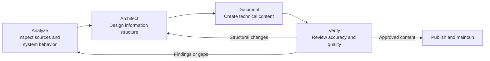

# Documentation Engineering Lifecycle

The lifecycle connects technical investigation, information design, content development, and quality verification. Verification findings can send work back to analysis or architecture; the process is iterative rather than strictly linear.

## Stage outputs

| Stage | Main output |
| --- | --- |
| Analyze | Source inventory, verified facts, gaps, technical findings |
| Architect | Information model, navigation, document types, terminology |
| Document | API references, architecture descriptions, data models, guides |
| Verify | Review findings, validation results, traceability, release readiness |

**Evidence boundary:** completion of a stage is established by its artifacts and review records, not by the diagram itself.
