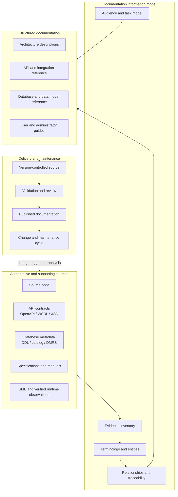

# Documentation Architecture

This view describes the logical flow from authoritative technical sources to maintained documentation products. It is a conceptual model; an individual project may use only some source types or publication targets.

## Architectural rules

- Keep source evidence distinct from authored interpretation.
- Organize content by audience, task, and information type.
- Link related entities and documents through stable identifiers and references where practical.
- Select formats and publication tooling according to the project, not by default.
