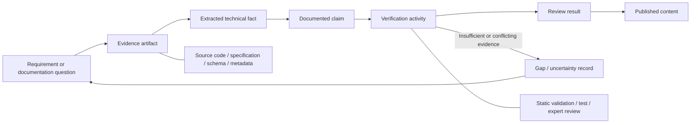

# Evidence and Traceability

The traceability model connects a documented statement to the evidence that supports it and to the review performed on that statement.

## Traceability record

| Field | Purpose |
| --- | --- |
| Claim or topic ID | Identifies the documented statement or requirement |
| Source artifact | Identifies the file, specification, schema, or observation |
| Evidence location | Points to a section, symbol, operation, table, or line range |
| Interpretation | Records the conclusion drawn from the evidence |
| Verification method | States how the claim was checked |
| Status | Verified, partially verified, inferred, or unresolved |
| Document location | Identifies where the claim is published |

**Important:** a source artifact does not automatically prove runtime behavior. A specification describes a contract; source code shows implementation artifacts; runtime behavior requires suitable execution evidence.
