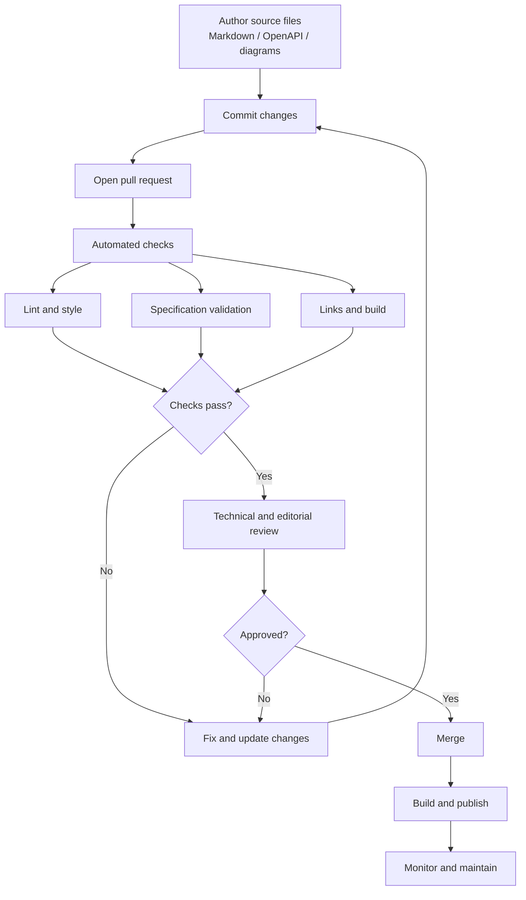

# Docs-as-Code Workflow

This workflow shows a typical Git-based documentation delivery pipeline. Exact checks and deployment steps depend on repository configuration.

## Workflow controls

- Review changes through version control.
- Validate structured specifications with the relevant validators.
- Run linting, link checks, and documentation builds where configured.
- Treat a successful pipeline as evidence that configured checks passed, not as proof of technical correctness.
- Record publication failures and maintenance changes.
